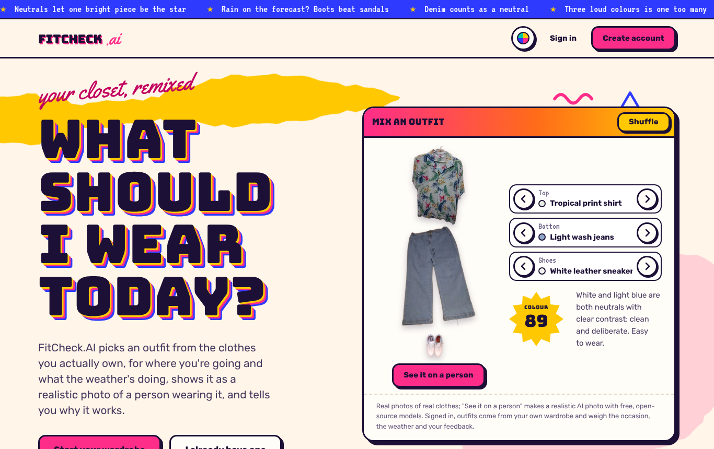
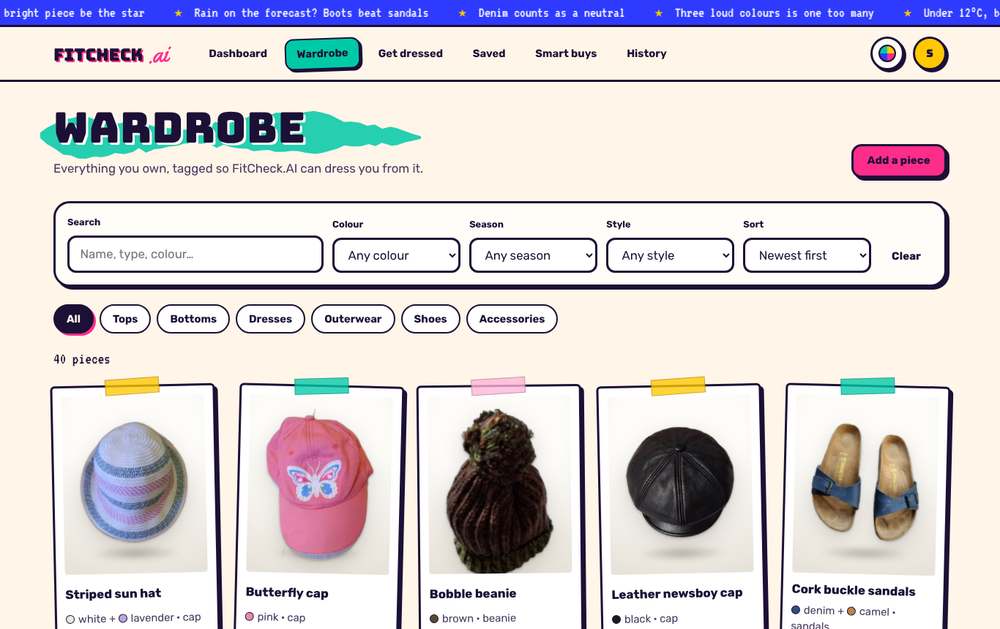
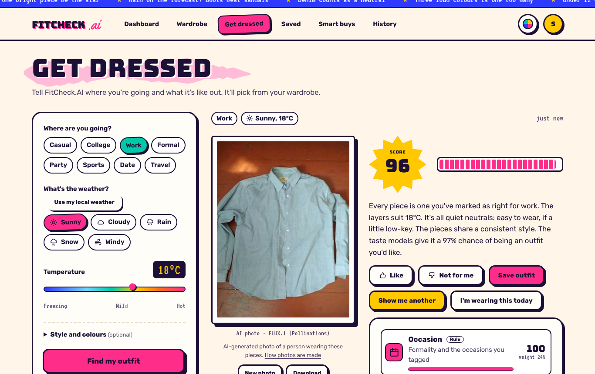
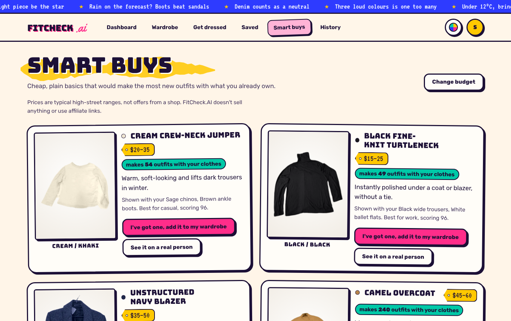
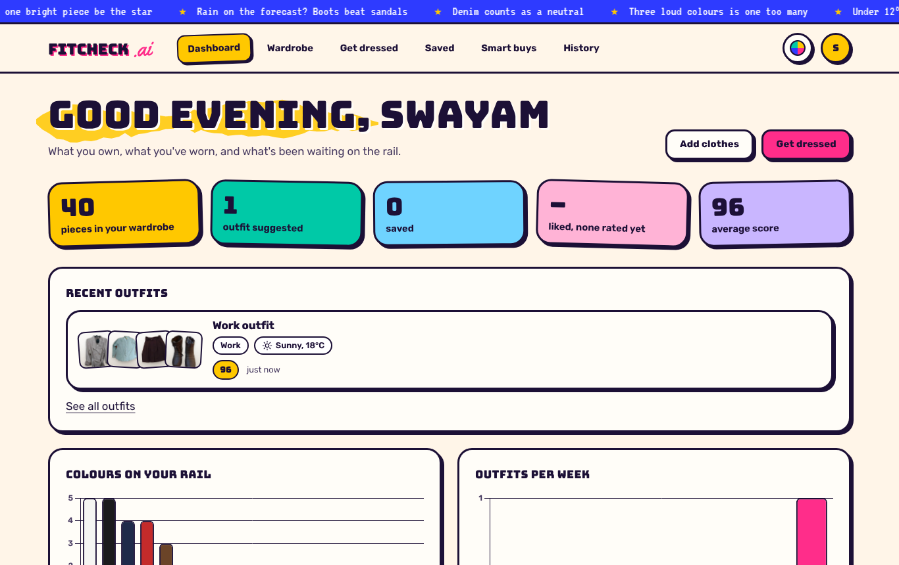
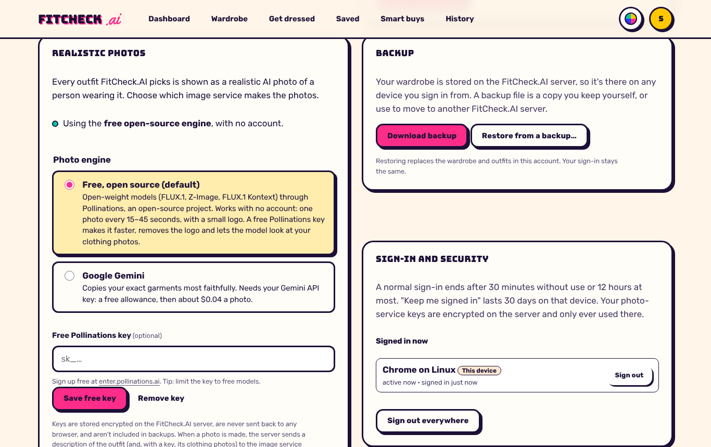
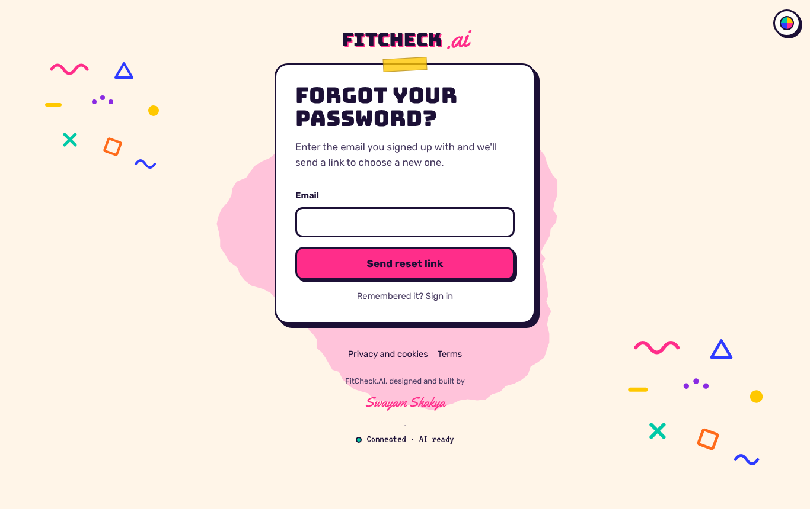
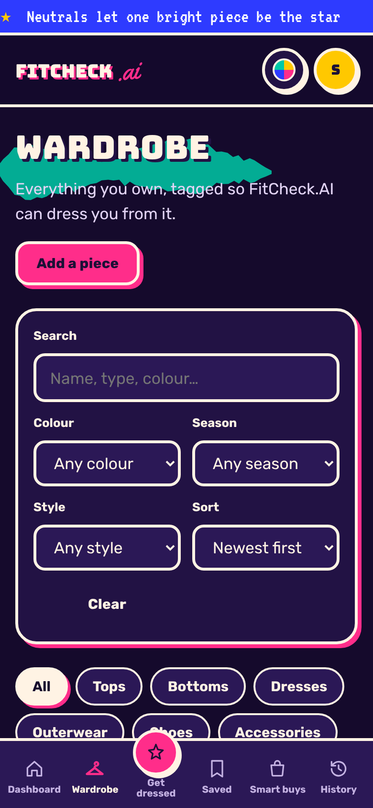

# FitCheck.AI

**A web app that answers "what should I wear today?" using the clothes you actually own,
and shows the answer as a realistic photo of a person wearing them.**

Designed and built by **Swayam Shakya**.

FitCheck.AI is a complete web application: a **Flask** server with a **MySQL** database
behind a single website. Sign in from any phone or computer and your wardrobe, photos,
outfits and preferences are there. Outfit photos are made on the server by free,
open-source image models (through Pollinations) or by Google Gemini with your own key, so
keys never touch the browser.

---

## Screenshots

| | |
|---|---|
|  |  |
|  |  |
|  |  |
|  |  |

Taken from the running app in the build environment. The photo services can't be
reached there, so the outfit photo in *Get dressed* is the test stand-in (a garment
picture), not a real AI photo of a person.

## The problem

Most people wear a small part of what they own. Getting dressed means juggling the plan
for the day, the weather, what goes with what, and what's clean, so the same few outfits
come out again and again.

FitCheck.AI keeps a tagged record of your wardrobe. For a given occasion and weather, it
builds an outfit only from pieces you own, scores it 0–100 with a plain-language
explanation, and photographs it: a real-looking person wearing exactly those clothes,
catalogue style and cropped at the chin. Suggestions adapt to what you like and skip.
When you do want to buy something, **Smart buys** suggests the cheap, plain basic that
makes the most new outfits with what you have.

## Features

- **Accounts:**
  - sign up, sign in, "keep me signed in", sign out, and sign out everywhere;
  - forgot your password? A one-time link by email; see every signed-in device and sign
    any of them out;
  - change your password, delete your account, and back up or restore everything.
- **Digital wardrobe:**
  - add, edit and remove pieces with a photo, category, type, colours, seasons, style,
    occasions and notes;
  - search, filter and sort;
  - a one-click **demo wardrobe** of 40 real photographed pieces.
- **Real clothes, catalogue look:**
  - uploads are cut out of their background in the browser (U²-Net-p, WebAssembly) and
    shown as packshots on a studio sweep;
  - the main colour is suggested from the photo;
  - no photo? Type "black hoodie" and you get a real photographed hoodie dyed black.
- **Realistic outfit photos:**
  - free and open source by default, with no setup (FLUX.1 via Pollinations);
  - a free Pollinations key unlocks Z-Image Turbo and the editing models FLUX.2 [klein] /
    Qwen-Image / Kontext, which look at your real clothing photos;
  - or use Google Gemini with your own key;
  - choose the person (build, skin tone, body type) and the setting (studio, or a place
    that fits the plan);
  - the last four takes are kept; pick the one you like, download or share it.
- **Outfit generator:**
  - choose the occasion, weather and temperature, or press **Use my local weather**
    (Open-Meteo);
  - optionally set a style and palette;
  - like, "not for me", save, or show another.
- **"I'm wearing this today":** pieces worn in the last three days rest in new suggestions.
- **Explained scores:** a breakdown of occasion, weather, colour, style, learned taste and
  your own feedback.
- **Saved lookbook, history and dashboard**, with Chart.js charts.
- **Smart buys:** 34 affordable, unbranded basics, ranked by how many good outfits each
  one unlocks.
- **Works offline and installs like an app:** pages you've opened (and the app's core
  pages) open without a connection, and FitCheck.AI can be added to a phone's home screen.
  Your data is never stored in the browser.
- **Light and dark mode**; phone, tablet and desktop layouts.

## Technology

| Layer | Tools |
|---|---|
| Server | Python 3.13, Flask 3.1, gunicorn; JSON API under `/api`, pages served from the same origin |
| Database | MySQL 8 (PyMySQL), 13 tables with foreign keys and CHECK constraints (`backend/schema.sql`) |
| Recommendation engine | `ml/fitcheck_ml`: rules (CIEDE2000 colour harmony, occasion, weather, style) + scikit-learn Decision Tree and KNN (joblib) |
| Photos | `backend/photo_engine.py`: Pollinations (FLUX.1, Z-Image, FLUX.2 klein, Qwen-Image, Kontext) or Google Gemini |
| Security | scrypt passwords, server sessions in HttpOnly cookies, CSRF tokens, rate limits, Fernet-sealed keys, CSP and security headers |
| Front end | HTML, CSS, vanilla JavaScript ES modules (no build step); onnxruntime-web for cut-outs; Chart.js |
| Tests | pytest, Playwright (Chromium), Node |
| Deployment | Render blueprint (`render.yaml`), Dockerfile and `docker-compose.yml` |

## Install and run

You need **Python 3.13** and **MySQL 8**, or just **Docker**. Full instructions, including
going live on Render, are in [`docs/DEPLOYMENT.md`](docs/DEPLOYMENT.md).

### Option A: Docker (one command)

```bash
cp .env.example .env
# edit .env: set SECRET_KEY (32+ random characters) and DB_PASSWORD
docker compose up --build
# open http://localhost:8000
```

### Option B: Python + your own MySQL

```bash
# 1. a database and a user with rights on it only
mysql -u root -p -e "CREATE DATABASE fitcheck CHARACTER SET utf8mb4;
  CREATE USER 'fitcheck_app'@'localhost' IDENTIFIED BY 'choose-a-long-password';
  GRANT ALL ON fitcheck.* TO 'fitcheck_app'@'localhost';"

# 2. the server
python -m venv .venv && source .venv/bin/activate      # Windows: .venv\Scripts\activate
pip install -r backend/requirements.txt
cp .env.example .env                                   # fill in SECRET_KEY and DB_PASSWORD
# local http needs COOKIE_SECURE=0 in .env
set -a; source .env; set +a                            # Windows: set each variable instead

# 3. tables, then start
cd backend
python init_db.py
gunicorn wsgi:app --bind 127.0.0.1:8000                # Windows: flask --app wsgi run --port 8000
# open http://localhost:8000
```

Then create an account and press **Try it with a demo wardrobe**.

### Option C: live on the web (Render)

Push the project to GitHub, then go to Render → **New → Blueprint** and pick the
repository. `render.yaml` creates the web service and a private MySQL service with a
disk, and generates `SECRET_KEY`. It asks you for one database password, used twice. See
[`docs/DEPLOYMENT.md`](docs/DEPLOYMENT.md).

## How an outfit is chosen

1. **Shortlist:** score each piece for the occasion, weather and style, and keep the best
   few per slot.
2. **Combine:**
   - every top + bottom + shoes, and dress + shoes;
   - outerwear when it's cool, wet or windy;
   - accessories only when they help.
3. **Rules:** occasion (tags and formality), weather (warmth against a target, seasons,
   rain/snow readiness), colour (CIEDE2000 in CIELAB: neutral, tonal, analogous,
   complementary or clash, adjusted by your palette and colours) and style agreement.
4. **Learned taste:** a Decision Tree and KNN predict how likely you are to like it.
5. **Your feedback:** after three ratings, a nearest-neighbour lookup over your own likes
   and dislikes.
6. **Blend** to 0–100. Pieces worn in the last three days rest.

## Machine learning

The notebook [`notebooks/FitCheck_AI_ML_Analysis.ipynb`](notebooks/FitCheck_AI_ML_Analysis.ipynb)
covers dataset creation, cleaning, EDA, feature engineering, KNN and Decision Tree
training, evaluation, colour analysis, model comparison and Joblib export to `ml/models/`,
which the server loads.

Ratings are **simulated**: 320 people rate 10,240 outfits. Results on 64 held-out people:

| Model | Accuracy | F1 | ROC AUC |
|---|---|---|---|
| Majority class | 0.665 | 0.799 | 0.500 |
| Rules only | 0.712 | 0.753 | 0.811 |
| KNN | 0.739 | 0.826 | 0.809 |
| Decision Tree | 0.735 | 0.816 | 0.795 |
| Hybrid (what the app ranks by) | 0.721 | 0.760 | **0.818** |

## Limitations

- **Photos depend on outside services.** The free tier can be busy (the app explains this
  and offers Try again). How faithfully a photo copies your garments depends on the
  engine: the reference-image models (free key or Gemini) are the most faithful.
- **Live photo services weren't reachable from the build environment**, so photo flows
  were tested against a fake that answers in their formats.
- **Ratings used for training are simulated**; the app learns your taste as you rate.
- **Password-reset email needs an SMTP provider** (any: Brevo, Mailgun, SendGrid, SES).
  Without one, development prints links to the server log and production operators use
  `python backend/manage.py reset-link <email>`.

## Author

**Swayam Shakya** designed and built FitCheck.AI: the interface, the Flask/MySQL server,
the security layer, the recommendation engine, the photo engines and the
machine-learning notebook.
